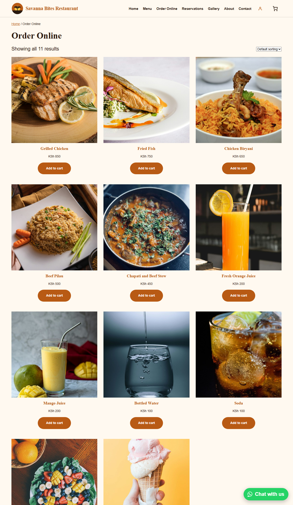
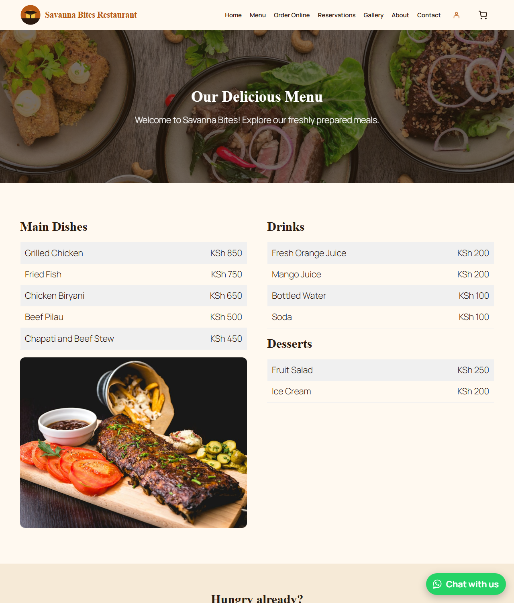
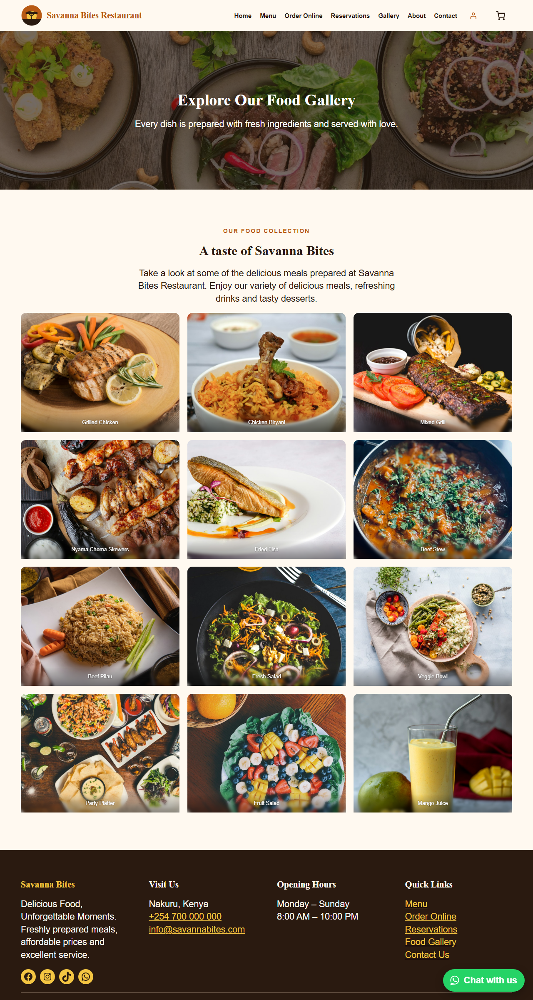
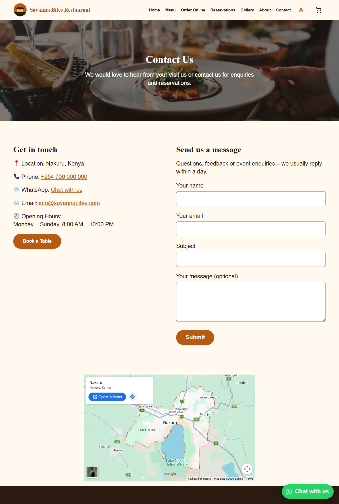

# 🌅 Savanna Bites Restaurant – WordPress Website

A complete restaurant website built with **WordPress** for *Savanna Bites*, a restaurant in Nakuru, Kenya.
Customers can browse the menu, **order food online**, **book a table**, view the food gallery and get in touch,
on desktop and mobile.

> *Delicious Food, Unforgettable Moments*



---

## ✨ Features

| Feature | How it works |
|---|---|
| 🏠 **Home page** | Hero banner, weekly special offer, specialties with prices, "Why choose us", customer reviews and a booking call-to-action |
| 📋 **Menu** | Main dishes, drinks and desserts with prices in KSh |
| 🛒 **Online ordering** | Every menu item is a **WooCommerce** product with a cart and checkout. Customers pay on delivery or pickup (cash or M-Pesa). Staff manage orders in *WooCommerce → Orders* |
| 📅 **Table reservations** | Booking form (date, time, party size up to 20) using **Five Star Restaurant Reservations**. Bookings arrive as *Pending* so staff can approve or reject them in *Bookings* |
| 🖼️ **Food gallery** | 12 photos in a cropped 3-column gallery |
| ✉️ **Contact page** | **Contact Form 7** form, Google Map of Nakuru, phone, email and opening hours |
| 💬 **WhatsApp button** | Floating "Chat with us" button on every page (custom plugin) |
| 🎨 **Branding** | Custom logo and favicon (drawn in PHP), savanna colour palette, Roboto Slab and Manrope fonts |
| 📱 **Responsive** | Collapsible ☰ menu on phones and tablets, sticky header, mobile-friendly layouts |
| 🔒 **Privacy Policy** | Explains what data the forms, bookings and orders collect |

## 🧰 Built with

- **WordPress 7.1** with the **Twenty Twenty-Five** block theme (customised in Global Styles)
- **WooCommerce** – online ordering
- **Contact Form 7** – contact form
- **Five Star Restaurant Reservations** – table bookings
- **Savanna Bites Extras** – my own plugin (see below)
- **WordPress Studio** – local development environment (PHP 8.4, SQLite)

## 📁 What's in this repository

```
├── _build/
│   ├── build-site.php      # Builds the whole site: pages, menu items, settings, header, footer, styles
│   └── images/             # Food photos and the logo, imported into the Media Library by the script
├── wp-content/plugins/
│   └── savanna-bites-extras/
│       ├── savanna-bites-extras.php   # WhatsApp button + simplified Kenyan checkout fields
│       └── assets/style.css           # Styling for the header, forms and WhatsApp button
└── screenshots/            # Screenshots of each page
```

WordPress itself and the public plugins are **not** stored here, because they are installed from
wordpress.org (they add up to about 400 MB). The database is not stored here either: the build script
recreates all the content.

### The custom plugin – *Savanna Bites Extras*

- Adds a floating **WhatsApp chat** button (`wp_footer` hook).
- Simplifies the **WooCommerce checkout** for Kenya: no postcode or county, and the address is optional
  for pickup orders (`woocommerce_get_country_locale` filter).
- Styles the contact and reservation forms and makes the menu collapse on tablets.

## 🚀 How to run it

1. Install **[WordPress Studio](https://developer.wordpress.com/studio/)** and turn on the CLI
   (*Settings → Studio CLI for terminal*).
2. In Studio, click **Add site** and create a new site (e.g. *Savanna Bites*).
3. Download this repository and copy two folders into the new site's folder:
   - `_build/` → into the site folder
   - `wp-content/plugins/savanna-bites-extras/` → into the site's `wp-content/plugins/`
4. Open a terminal **in the site folder** and run:

   ```bash
   studio wp plugin install woocommerce contact-form-7 restaurant-reservations --activate
   ```

   ```bash
   studio wp plugin activate savanna-bites-extras
   ```

   ```bash
   studio wp eval-file _build/build-site.php
   ```

5. Open the site from Studio. Everything (pages, menu items, logo, colours and settings) is created
   automatically. The script is safe to run again at any time.

## 🖼️ Screenshots

| Menu | Food Gallery | Contact |
|---|---|---|
|  |  |  |

## 📝 Notes

- Phone numbers, the email address and the social media links are **placeholders** for the demo.
- Customer reviews on the home page are sample content.
- Food photos are from [Unsplash](https://unsplash.com) (free to use under the Unsplash License).
- Payments are "pay on delivery/pickup". M-Pesa online payment could be added later with a payment
  gateway plugin.

## 👤 Author

Savanna Bites Restaurant website – WordPress project.
